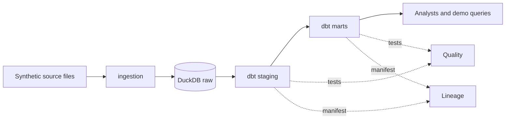

# Architecture Principles

This document defines the core contract. Project-specific decisions belong in `docs/architecture/` and `docs/adr/`.

The detailed source of truth is under `policies/architecture/`: `architecture-principles.md` and `dependency-principles.md`. Their stable IDs are intended for future automated enforcement.

| Principle | Requirement | Automated check | Human decision |
|---|---|---|---|
| Clear boundaries | Separate domains, infrastructure, policy, and delivery concerns. | Repository structure validation; dependency checks. | Approve boundary changes in review. |
| Explicit dependencies | Dependencies are declared, justified, pinned or constrained, and scanned. | Dependency and license checks. | Approve exceptions and major upgrades. |
| Secure interfaces | APIs validate input, authenticate callers, authorize actions, and avoid leaking sensitive data. | SAST and policy checks. | Review trust-boundary changes. |
| Data ownership | Each dataset has an owner, classification, contract, retention, and access path. | Data-policy and contract checks where configured. | Approve classification and retention. |
| Cloud neutrality | Core rules do not depend on one cloud vendor. | Forbidden-provider checks in core paths. | Approve stack overlays. |
| Observable systems | Services expose health, logs, metrics, traces where applicable, and actionable alerts. | Required observability documentation. | Set service-level objectives. |
| Reproducible delivery | Build once, identify artifacts by commit, and promote the same artifact. | CI/CD workflow checks. | Approve release and rollback policy. |

## Allowed patterns
- Modular monoliths or services with explicit ownership.
- Versioned APIs and data contracts.
- Infrastructure represented as reviewed code.
- Synchronous calls for bounded work and asynchronous messaging for durable workflows.
- Provider-specific implementations behind stack-overlay boundaries.

## Prohibited patterns
- Shared mutable databases across unrelated domains without an approved contract.
- Secrets or environment-specific credentials in source control.
- Unbounded synchronous chains, hidden network calls, or undocumented data copies.
- Vendor-specific code in core policy and governance paths.
- Architecture changes without an ADR when they affect boundaries, data, security, cost, or operations.

## Architecture baseline
The approved architecture boundaries are recorded in `docs/architecture/baseline.yaml` (`ARCH-BL-001` to `ARCH-BL-004`). The baseline locks boundaries, not developer decisions. `bash scripts/validate-baseline.sh` classifies each PR as `NO_BASELINE_IMPACT`, `BASELINE_IMPACT`, or `ARCHITECTURE_CHANGE`. An `ARCHITECTURE_CHANGE` requires an ADR with `Baseline impact: change`; agents advise, CI enforces the deterministic rule, and the architecture owner decides.

## ADR triggers
Create an ADR for a new service, external dependency, data store, public API, model/provider, RAG source, guardrail change, infrastructure pattern, security exception, or breaking change.

## Project architecture: demo data platform
Pattern: a single-repository modular monolith run as a batch pipeline. One DuckDB file per environment is the only data store. No services, no cloud provider, no AI components. Status: scaffold; pending ADR and baseline approval.

### Components and responsibilities

| Component | Path | Responsibility | Must not |
|---|---|---|---|
| Ingestion | `src/ingestion/` | Validate source files against their data contract and load them idempotently into `raw`. | Transform business logic; write outside `raw`. |
| Store | `data/*.duckdb` (gitignored) | Hold `raw`, `staging`, and `marts` schemas for one environment. | Be shared across environments; be committed. |
| Staging | `src/transform/models/staging/` | Type, rename, and deduplicate `raw` data one-to-one per source table. | Join sources; hold business rules. |
| Marts | `src/transform/models/marts/` | Business-ready facts and dimensions built from staging. | Read `raw` directly. |
| Quality | dbt tests and contracts | Enforce DATA-CON-003 checks; fail the run on violation. | Mutate data. |
| Lineage | dbt manifest and docs | Document sources, transformations, and consumers (DATA-003). | Be maintained by hand. |

### Allowed dependencies
A component may depend only on what is listed in its row. Anything else is prohibited.

| Component | May depend on |
|---|---|
| Ingestion | Python standard library, approved third-party libraries, DuckDB, `config/<env>` |
| Staging | `raw` sources only |
| Marts | Staging models only |
| Quality | The models it tests |
| Lineage | dbt manifest |

Rules: dependencies point one way (`raw` to `staging` to `marts`); ingestion and transform never import each other and communicate only through the DuckDB `raw` schema; each new third-party dependency needs a record under ARCH-DEP-001 before adoption.

### Architecture rules

| Rule | Requirement | Enforcement |
|---|---|---|
| PLAT-001 | Only `src/ingestion/` writes to `raw`. | Review (not yet automated) |
| PLAT-002 | `marts` models reference only staging models. | Review (not yet automated) |
| PLAT-003 | Environment databases are separate files; none is committed. | `.gitignore`; secret and structure checks |
| PLAT-004 | Changes to the store, platform, or environment set are architecture changes. | `scripts/validate-baseline.sh` once the matching boundaries are approved in `docs/architecture/baseline.yaml` |
| PLAT-005 | Every shared dataset has a data contract before it is loaded. | Review (not yet automated) |

Change control: the baseline is edited only by a human architecture owner. Changes that cross the boundaries above require an ADR with `Baseline impact: change`.
